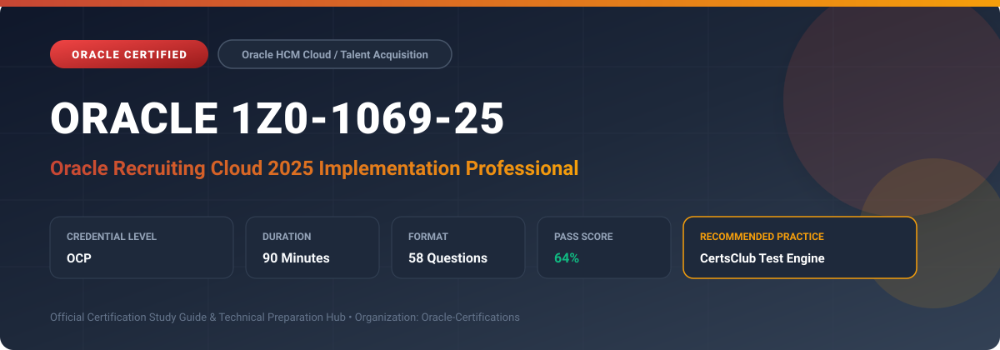

  

# Oracle 1Z0-1069-25: Oracle Recruiting Cloud 2025 Implementation Professional

---

## 1. Exam Overview & Candidate Profile

The **Oracle 1Z0-1069-25: Oracle Recruiting Cloud 2025 Implementation Professional** examination is designed for cloud professionals, enterprise architects, implementation consultants, and systems administrators who demonstrate deep practical knowledge and operational competence in deploying, configuring, and optimizing Oracle technologies.

The Oracle Recruiting Cloud 2025 Implementation Professional (1Z0-1069-25) certification demonstrates knowledge of configuring Oracle Fusion Recruiting Cloud. Key topics include career site customization, candidate job applications, candidate selection processes (CSP), job requisitions, candidate sourcing pools, offer management lifecycles, and seamless transition to Core HR onboarding.

### Target Audience & Prerequisites
- **Target Roles**: Implementation Consultants, Cloud Solution Architects, DevOps/SysOps Engineers, and Enterprise Functional Analysts.
- **Recommended Experience**: 1–2 years of hands-on experience in configuring, administering, or implementing the relevant Oracle solutions.
- **Credential Earned**: Oracle Certified Professional (OCP).

---

## 2. Key Exam Specifications

| Specification | Details |
| :--- | :--- |
| **Exam Code** | **Oracle 1Z0-1069-25** |
| **Official Title** | Oracle Recruiting Cloud 2025 Implementation Professional |
| **Certification Track** | Oracle HCM Cloud / Talent Acquisition |
| **Exam Duration** | 90 Minutes |
| **Number of Questions** | 58 Questions |
| **Passing Score** | 64% |
| **Question Format** | Multiple Choice (Single/Multiple Answer), Scenario-Based Questions |
| **Delivery Provider** | Oracle University / Pearson VUE (Online Proctored or Test Center) |
| **Recommended Practice Engine** | [CertsClub Oracle Practice Tests](https://www.certsclub.com/oracle/1z0-1069-25-dumps.html) |

---

## 3. Official Blueprint & Exam Domain Breakdown

The examination assesses candidate competencies across core functional domains weighted as follows:

| Domain Area | Weighting |
| :--- | :--- |
| **Recruiting Setup, Security, & Geography** | `15%` |
| **Job Requisition Creation & Approvals** | `20%` |
| **Candidate Selection Process (CSP) Configuration** | `25%` |
| **Career Sites, Candidate Experience, & Pools** | `20%` |
| **Job Offers, Approvals, & Onboarding Integration** | `20%` |

---

## 4. Deep Dive into Complex & Challenging Technical Topics

To secure a passing score on the 1Z0-1069-25 exam, candidates must master the following advanced concepts:

- Building customized Candidate Selection Processes (CSP) with dynamic phases, states, and automated trigger actions.
- Configuring external branded career sites with custom CSS, multi-language support, and talent community enrollment.
- Designing offer letter templates with BI Publisher data models, tokenized attributes, and electronic signatures.
- Setting up candidate pools, campaigns, agency recruiter portals, and interview scheduling workflows.

---

## 5. Scenario-Based Demo & Practice Questions

### Question 1
In Oracle Recruiting Cloud, what controls the progression of a job applicant through sequential hiring stages (such as Screening, Interview, and Offer)?

A) Candidate Selection Process (CSP)
B) Career Site Configuration Profile
C) Payroll Element Setup
D) Performance Document Template

- **Correct Answer**: `A) Candidate Selection Process (CSP)`
- **Technical Explanation**: The Candidate Selection Process (CSP) defines the specific phases and states a candidate traverses during the hiring lifecycle, along with automated notifications and background check actions.

---

### Question 2
What happens when an approved job offer is accepted by a candidate and moves to the 'HR - Processed' state in Oracle Recruiting Cloud?

A) The candidate profile is automatically deleted from the database
B) A pending worker or employee record is created in Oracle Global Human Resources
C) The job requisition is automatically canceled
D) The candidate is redirected to a third-party job board

- **Correct Answer**: `B) A pending worker or employee record is created in Oracle Global Human Resources`
- **Technical Explanation**: When an offer is moved to HR, Oracle Recruiting Cloud synchronizes worker details, job assignment, compensation, and manager relationships into Oracle Global HR as a pending worker or active employee.

---

## 6. Recommended Preparation Strategy & Practice Testing Engine

Achieving certification in **Oracle 1Z0-1069-25** requires balanced theoretical study and scenario-based simulation practice:

1. **Review Oracle Documentation**: Master architecture guides, implementation workbooks, and administration manuals on the Oracle Help Center.
2. **Hands-on Lab Practice**: Execute real-world configuration, policy setup, and troubleshooting tasks in your cloud tenancy or test instance.
3. **Simulated Exam Drills**: Practice answering timed, scenario-based multiple-choice questions to familiarize yourself with the question formats, traps, and timing constraints.

### Practice With CertsClub
For realistic practice questions, updated dumps, and mock testing environments:
- **Resource**: [CertsClub Oracle Practice Test Engine](https://www.certsclub.com/oracle/1z0-1069-25-dumps.html)
- **Special Discount**: Use coupon code **`club20`** during checkout for an instant **20% discount** on all practice exam bundles and testing engines.

---

## 7. Official Documentation & References

- [Oracle University Certification Registry](https://education.oracle.com/)
- [Oracle Help Center Documentation Portal](https://docs.oracle.com/)
- [Oracle Cloud Infrastructure & Applications Guides](https://docs.oracle.com/en/cloud/)
- [CertsClub Oracle Certification Exam Practice](https://www.certsclub.com/oracle/1z0-1069-25-dumps.html)

---

## 8. SEO & Discovery Keywords

`oracle 1z0-1069-25`, `oracle 1z0-1069-25 exam`, `oracle 1z0-1069-25 dumps`, `1Z0-1069-25 practice questions`, `1Z0-1069-25 study guide`, `oracle 1z0-1069-25 syllabus`, `oracle recruiting cloud 2025 implementation professional`, `certsclub 1z0-1069-25`